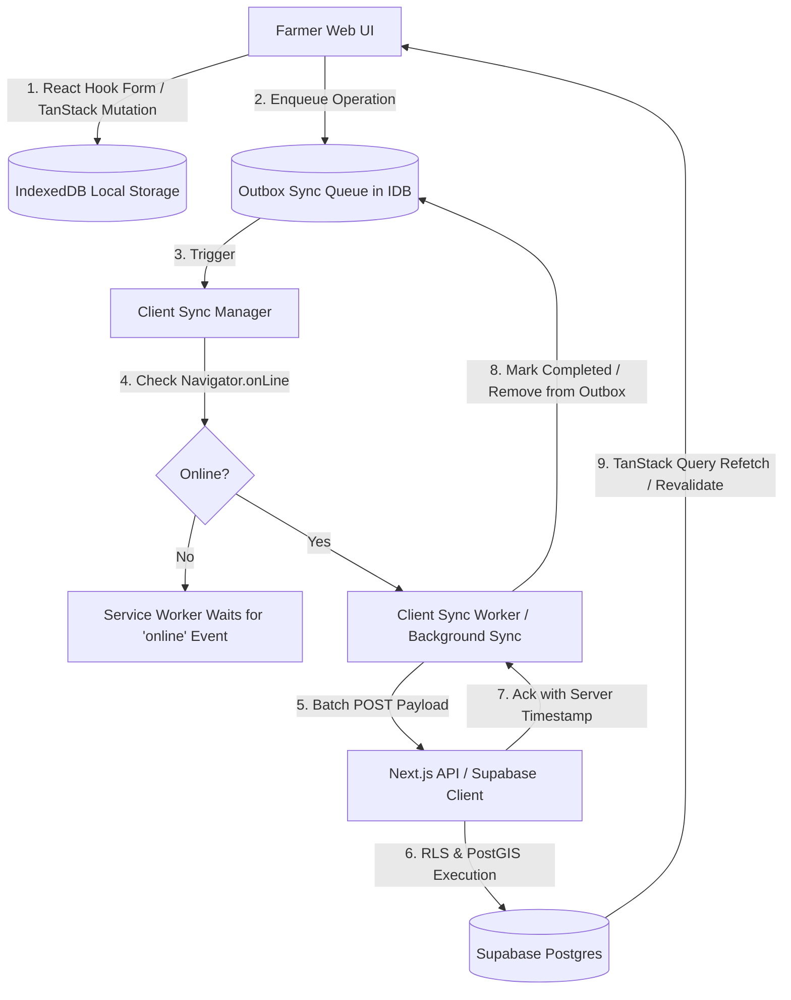

# FarmerOS — System Architecture & Technical Specification

## 1. Technology Stack

| Layer | Component | Selection & Rationale |
|---|---|---|
| **Web Framework & SSR** | **Next.js 15+ (App Router) + TypeScript** | React Server Components (RSC) for lightning-fast initial load times, automatic code-splitting, small initial JS payloads, and streaming SSR—critical for entry-level smartphones on 2G/3G/4G. |
| **Styling & Design System** | **Tailwind CSS + shadcn/ui** | Zero runtime CSS-in-JS overhead, predictable atomic styling, accessible Radix UI primitives, highly customized to match the agricultural design palette. |
| **Data Fetching & State** | **TanStack Query (React Query v5)** | Robust client cache, automatic background refetching, mutation lifecycle hooks, offline caching integration, and optimistic UI updates. |
| **Form Handling & Validation** | **React Hook Form + Zod** | Uncontrolled forms with near-zero re-renders on low-spec CPUs; strict schema validation shared across client and API routes. |
| **Charts & Visualization** | **Recharts** | Declarative, SVG-based responsive charting tailored for agricultural economics (yield trends, budget variance, rainfall distribution, cost breakdown). |
| **Mapping & GIS** | **Leaflet (`react-leaflet`) / MapLibre GL** | Lightweight, open-source mapping with OpenStreetMap tiles. Supports interactive polygon drawing, corner vertex editing, and GPS walking mode without expensive proprietary map SDK fees. |
| **Local Storage (Offline-First)** | **IndexedDB (`idb` / Dexie.js)** | High-capacity browser storage for offline farm records, boundary polygons, local photos, and the pending sync outbox. |
| **Progressive Web App (PWA)** | **Service Worker (Serwist / Workbox)** | App installability, offline asset caching, offline page fallbacks, and background sync triggers. |
| **Backend & Cloud Database** | **Supabase (PostgreSQL 15+)** | Managed Postgres with built-in connection pooling, real-time change streams, and automated backups. |
| **Geospatial Engine** | **PostGIS** | Native spatial types (`GEOMETRY(Polygon, 4326)`, `GEOMETRY(Point, 4326)`) enabling spherical geodesy, boundary validation, and spatial indexing (`GIST`). |
| **Backend Services & APIs** | **Supabase Edge Functions + Next.js Route Handlers** | Low-latency TypeScript/Deno serverless edge functions for external API integrations (weather, APMC mandi feeds), RAG orchestration, and heavy calculations. |
| **Authentication** | **Supabase Auth** | Passwordless Phone OTP authentication and session management tailored for rural Indian mobile users. |
| **Object Storage** | **Supabase Storage** | Private S3-compatible encrypted buckets for farm boundary photos, soil reports, and damage videos with signed URL access. |
| **Localization** | **`next-intl`** | Production-ready internationalization supporting English (`en`), Marathi (`mr`), and Hindi (`hi`) from day one with route-based localization (`/[locale]/...`). |
| **Telemetry & Observability** | **Centralized `AnalyticsService`** | Single event logging interface for product events (screen views, feature usage, sync drops, offline actions) combined with in-app explainable analytical dashboards. |

---

## 2. Directory Structure (App in Root, Supabase, Docs)

FarmerOS places the Next.js web application directly in the project root, keeping database migrations in `supabase/` and project documentation in `docs/`:

```
farmer-os/
├── app/                              # Next.js App Router
│   ├── [locale]/                     # Locale route segment (en, mr, hi)
│   │   ├── (auth)/                   # Authentication routes (login, phone-otp)
│   │   ├── (dashboard)/              # Authenticated farmer views
│   │   │   ├── layout.tsx            # Shell with FarmerHeader & MobileBottomNav
│   │   │   ├── page.tsx              # Home / Daily Briefing
│   │   │   ├── farms/                # Farm & Plot management
│   │   │   │   ├── page.tsx
│   │   │   │   ├── [farmId]/
│   │   │   │   │   ├── boundary/     # Interactive boundary polygon editor
│   │   │   │   │   └── evidence/     # Boundary evidence vault
│   │   │   ├── crops/                # Crop cycles, stages, tasks, diary
│   │   │   ├── finance/              # Crop budgets, expenses, P&L, break-even
│   │   │   ├── weather/              # Hyperlocal weather & spray windows
│   │   │   ├── market/               # Mandi rates, MSP, net realization
│   │   │   ├── ai/                   # AI crop scanner & voice assistant
│   │   │   ├── community/            # Social feed, Q&A, expert consultation
│   │   │   └── settings/             # Language, offline sync, profile
│   │   ├── layout.tsx                # Root HTML, fonts, providers
│   │   └── page.tsx                  # Landing / auto-redirect to active farm
│   ├── api/                          # Next.js Edge / Server Route Handlers
│   │   ├── weather/
│   │   ├── mandi/
│   │   └── sync/
│   ├── manifest.ts                   # PWA Web App Manifest
│   └── sw.ts                         # Service Worker setup
├── components/                       # Reusable React components
│   ├── ui/                           # shadcn/ui components (button, card, dialog, etc.)
│   ├── layout/                       # FarmerHeader, MobileBottomNav, LanguagePicker
│   ├── maps/                         # Leaflet polygon draw, GPS walking survey
│   ├── charts/                       # Recharts wrappers (CostChart, YieldTrend, PnLBar)
│   └── shared/                       # ProvenanceBadge, AudioButton, DataFreshnessTag
├── lib/                              # Core libraries & singleton services
│   ├── supabase/                     # Supabase client (client.ts, server.ts, middleware.ts)
│   ├── db/                           # IndexedDB schema, connection, and repositories
│   ├── sync/                         # Outbox sync queue manager & background worker
│   ├── analytics/                    # Central AnalyticsService interface & implementations
│   ├── geo/                          # Turf.js / geodesy calculation helpers
│   └── utils.ts                      # cn() class helper, currency format, date format
├── hooks/                            # Custom React hooks (useSync, useGeolocation, useTTS)
├── messages/                         # Localization dictionaries
│   ├── en.json
│   ├── mr.json
│   └── hi.json
├── public/                           # Static assets, icons, audio cues, offline fallback
├── supabase/                         # Backend migrations & serverless functions
│   ├── migrations/                   # SQL migrations (PostGIS, tables, RLS)
│   ├── functions/                    # Supabase Edge Functions (Deno / TypeScript)
│   └── seed.sql                      # Seed data (crops, varieties, packages)
├── docs/                             # Project documentation & roadmaps
├── middleware.ts                     # next-intl + Supabase session middleware
├── next.config.ts                    # Next.js configuration + PWA settings
├── tailwind.config.ts                # Tailwind design system tokens
├── tsconfig.json
└── package.json
```

---

## 3. Core Data Chain & Domain Model

The entire architecture is anchored around the hierarchical agricultural chain:

```
[Farmer / Identity]
        │
        ▼ (1:N)
    [Farm] ─────────────► [Farm Documents / Shares]
        │
        ▼ (1:N)
    [Plot] ─────────────► [Boundary Versions & Evidence Vault (Append-Only)]
        │
        ▼ (1:N)
    [Crop]
        │
        ▼ (1:N)
    [Season]
        ├───► [Daily Field Activities / Diary]
        ├───► [Irrigation Records & Schedules]
        ├───► [Spray & Medicine Logs]
        ├───► [Nutrient & Fertilizer Records]
        ├───► [Labor & Machinery Logs]
        ├───► [Budget vs Actual Expense Ledger]
        ├───► [Harvest Lots & Quality Grading]
        └───► [Market Sales & Revenue Realization]
```

### Architectural Data Invariants:
1. **Append-Only Measurement History**: Boundary polygons, corner GPS coordinates, side lengths, and survey evidence photos are stored in `boundary_versions` with monotonic version numbers (`version_number = 1, 2, ...`). Historical revisions are never updated or deleted in place.
2. **Universal Provenance Tagging**: Every recorded observation or advisory carries a provenance tuple:
   - `provenance_type`: `farmer_entered` | `ai_suggested` | `verified` | `expert_confirmed`
   - `source_name`: String identifier (e.g., "Farmer Entry", "IMD Pune Weather API", "Dr. Patil (KVK Baramati)")
   - `fetched_at`: UTC timestamp of measurement or retrieval
   - `confidence_score`: Float value between `0.0` and `1.0` (or `null` when not applicable)
3. **Observation vs. Prediction Separation**: Physical measurements (actual rainfall, recorded spray date, realized market price) are stored in discrete tables distinct from analytical projections (forecast rainfall, estimated harvest readiness, simulated profit).

---

## 4. Offline-First PWA & Synchronization Strategy

In rural areas with intermittent connectivity, FarmerOS functions as a true offline-first web application using a **Service Worker + IndexedDB Outbox Pattern**:



### Offline & Sync Mechanics:
- **Service Worker Caching**:
  - App Shell, fonts, UI icons, and critical JS chunks are pre-cached via Service Worker.
  - Offline fallback page with active farm selector when navigation occurs with no connectivity.
- **IndexedDB Schema**:
  - Stores local mirrors of active farms, plots, crops, recent diary entries, and offline map tile blobs.
  - Dedicated `sync_outbox` store tracking `{ id, table_name, operation, record_id, payload, created_at, retry_count, status }`.
- **Conflict Resolution**:
  - *Append-Only Entities* (Boundaries, logs, photos, audit records): Conflict-free by design (UUID collision-free inserts).
  - *Editable Entities* (Farmer profile, plot metadata): Server timestamp wins (`updated_at`). The client updates its local record upon acknowledgment.
- **Photo Ingestion**: Photos captured via mobile camera `<input type="file" capture="environment">` are stored as Blobs in IndexedDB. Metadata records sync immediately; binary blobs are uploaded to Supabase Storage in the background, updating the remote URL upon completion.

---

## 5. Security, Row Level Security (RLS) & Privacy

FarmerOS enforces **Privacy by Default**. Farmer land, financial ledger entries, and crop outputs are confidential personal data.

### Supabase RLS Matrix:
1. **Tenant Isolation**: Every core table (`farms`, `plots`, `crops`, `expenses`, `boundaries`) has a foreign key `farmer_id` referencing `auth.users(id)`.
2. **Default Policy**: `auth.uid() = farmer_id` for `SELECT`, `INSERT`, `UPDATE`, `DELETE`.
3. **Controlled Sharing via `farm_shares`**:
   - Sharing records specify: `farm_id`, `grantee_user_id` (or phone number), `role` (`viewer` | `advisor` | `worker` | `expert`), and `expires_at`.
   - RLS security functions permit access only if an active, unexpired share record exists.
   - Sharing is revocable at any instant by the farm owner.
4. **Audit Logging**: Sensitive mutations (boundary modifications, land-sharing grants, financial corrections) invoke a PostgreSQL trigger writing to `audit_logs` capturing `user_id`, `action`, `old_values`, `new_values`, and `ip_address`.

---

## 6. Optimization for Entry-Level Phones & Weak Connectivity

To guarantee smooth, responsive performance in mobile browsers on entry-level Android devices:

1. **Ultra-Lean Bundle Size**: Next.js Server Components mean zero client JS for static views. Dynamic imports (`next/dynamic`) for heavy modules (Leaflet maps, Recharts). Target initial client JS under 150KB gzip.
2. **Virtualization & DOM Pruning**: Virtualized lists (`@tanstack/react-virtual`) for lengthy transaction logs, mandi tables, and photo feeds to prevent browser tab crashes on 2GB RAM phones.
3. **Map Performance**: Leaflet with OpenStreetMap raster tiles; aggressive tile caching in IndexedDB/CacheStorage for mapped farm boundaries.
4. **Touch & Ergonomics**: Big touch targets (minimum 48dp, primary actions 56dp), high-contrast daylight text contrast ratios (WCAG AAA compliant), and Web Speech API audio read-aloud buttons.
